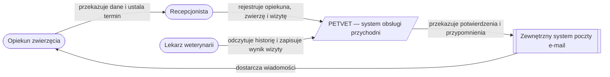
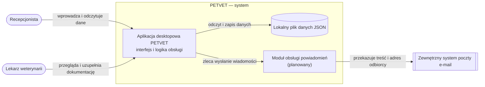
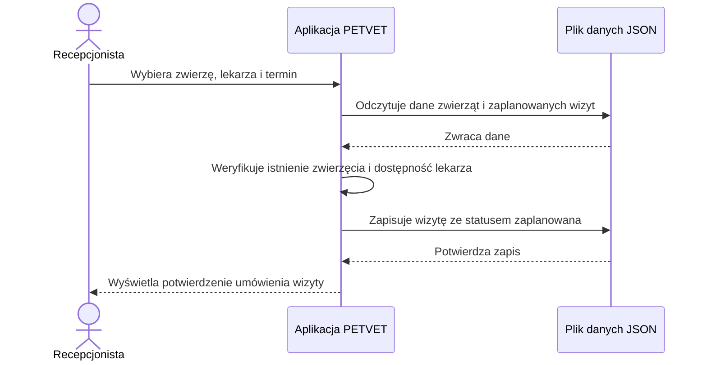
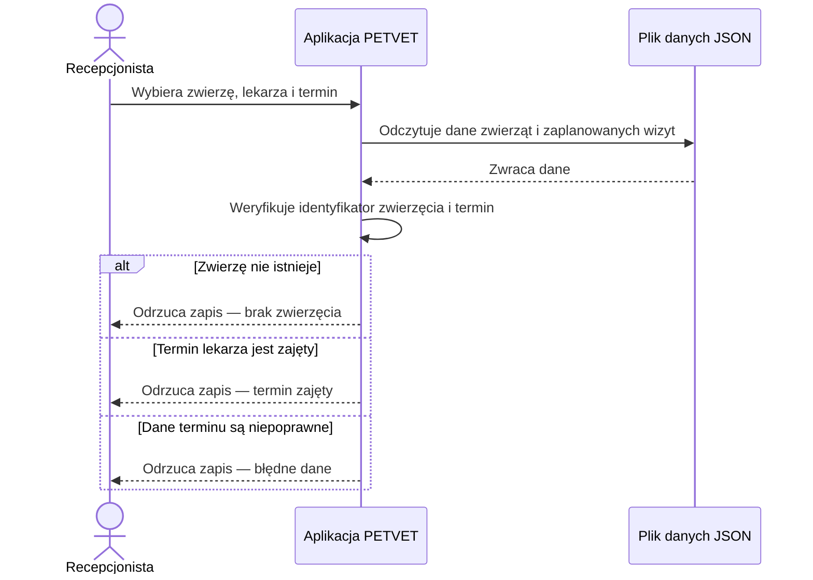
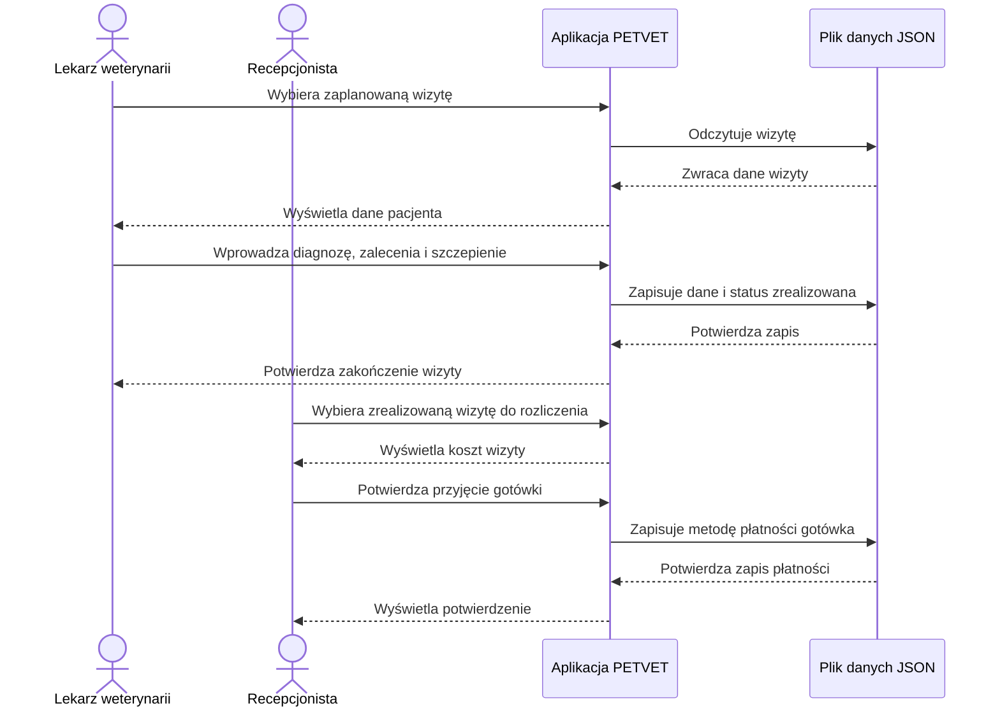
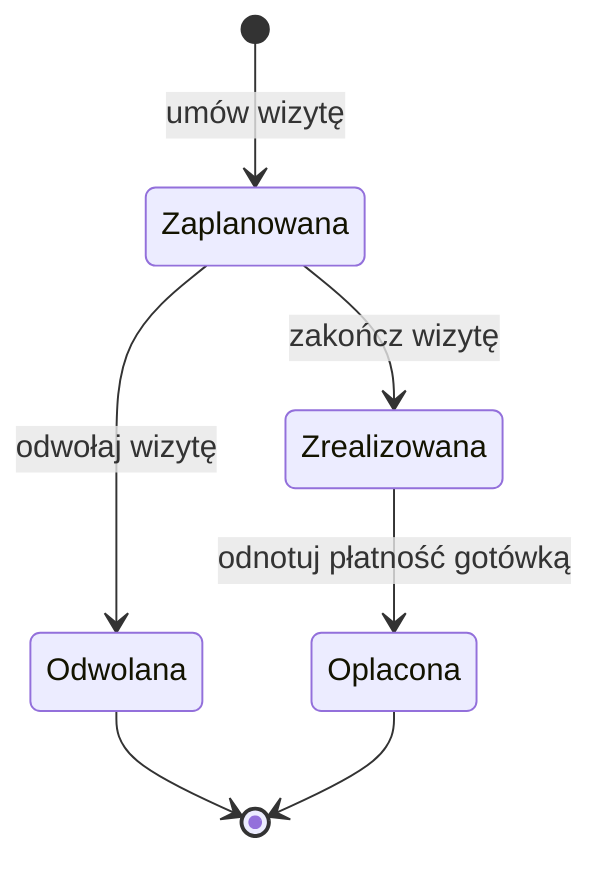
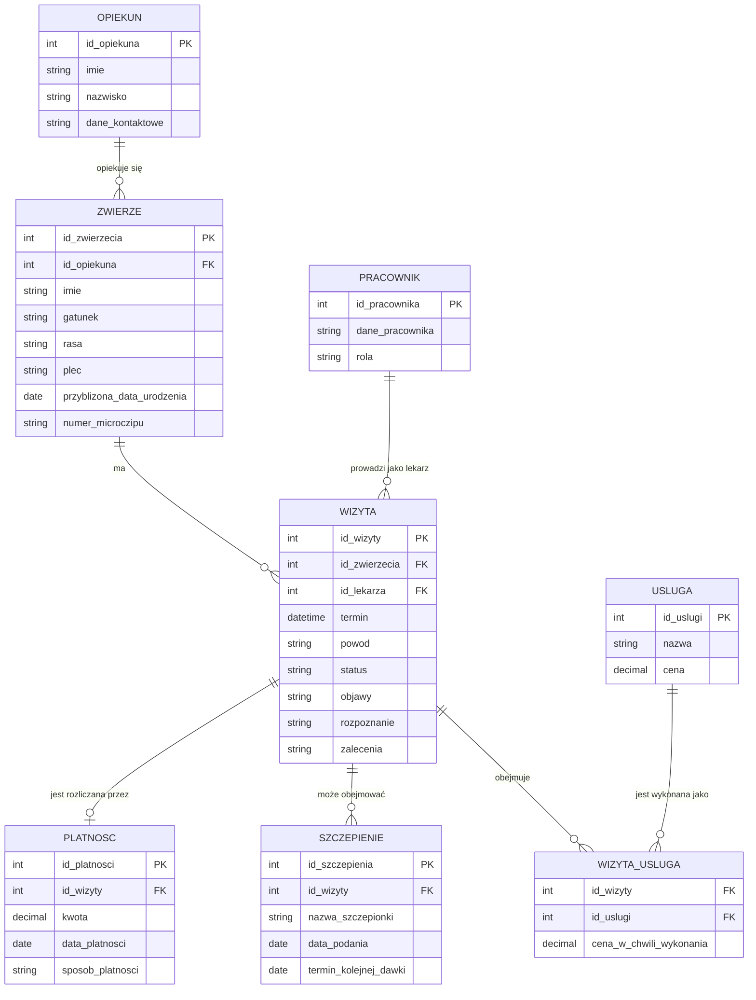

# PETVET — model architektury (Laboratorium 2)

> Diagramy są szkicem modelu docelowego. Przed oddaniem zespół powinien je sprawdzić względem zaakceptowanych historyjek i faktycznych decyzji. Nie wpisano technologii innych niż potwierdzone w obecnym rozwiązaniu. W szczególności integracja e-mail jest planowana.

## 1. C4 poziom 1 — diagram kontekstu

### Założenia
1. Opiekun kontaktuje się z przychodnią, a dane do PETVET wprowadza recepcjonista.
2. Lekarz korzysta z PETVET do przeglądania historii i dokumentowania wizyty.
3. System poczty e-mail jest zewnętrzną usługą, której integracja zostanie dopiero wykonana.

### Pytania
1. Czy opiekun w przyszłości będzie korzystał z własnego portalu?
2. Czy potwierdzenia i przypomnienia będą wysyłane automatycznie?
3. Kto zarządza konfiguracją konta pocztowego?

## 2. C4 poziom 2 — diagram kontenerów

### Założenia
1. Aplikacja desktopowa i lokalny plik JSON odpowiadają aktualnemu sposobowi działania programu.
2. Moduł powiadomień jest elementem planowanym, a nie istniejącym w przesłanym kodzie.
3. Nie modelujemy osobnego API ani serwera, ponieważ nie ma ich w obecnym rozwiązaniu ani w uzgodnionym zakresie.

### Pytania
1. Czy plik JSON pozostanie docelowym magazynem danych, czy zostanie zastąpiony bazą danych?
2. Czy wysyłka e-mail będzie realizowana przez serwer SMTP, czy usługę zewnętrznego dostawcy?
3. Czy aplikacja będzie używana na jednym stanowisku, czy przez kilka komputerów?

## 3. Diagram sekwencji — umówienie wizyty, ścieżka główna

## 4. Diagram sekwencji — umówienie wizyty, ścieżka błędu

### Zgodność z R-03
Ścieżka główna kończy się zapisem wizyty ze statusem „zaplanowana”. Ścieżka błędu obejmuje brak zwierzęcia, zajęty termin i niepoprawne dane terminu. Obecny kod sprawdza konflikt dla tego samego lekarza i identycznego terminu; pełne wykrywanie nakładających się przedziałów wymaga doprecyzowania i ewentualnej zmiany implementacji.

## 5. Diagram sekwencji — zakończenie wizyty i rozliczenie

## 5. Maszyna stanów wizyty

### Reguły przejść
- Wizytę zaplanowaną można zrealizować albo odwołać.
- Nie można odwołać wizyty już zrealizowanej.
- Płatność można odnotować dopiero po realizacji wizyty.
- W uzgodnionym zakresie metoda płatności to gotówka.
- Stany „Odwolona” i „Oplacona” są końcowe w tym uproszczonym modelu. Jeżeli przyjmiecie inne reguły, zaktualizujcie diagram.

## 6. Kontrola spójności
Przed zatwierdzeniem diagramów sprawdźcie:
- czy wszyscy aktorzy z `wymagania.md` występują na diagramie kontekstu;
- czy system e-mail jest oznaczony jako zewnętrzny;
- czy każda strzałka ma opis czynności lub przepływu;
- czy sekwencja odpowiada kryteriom akceptacji R-03;
- czy pokazano ścieżkę błędu;
- czy maszyna stanów nie dopuszcza niedozwolonych przejść;
- czy nazwy są językiem domeny przychodni, a nie nazwami klas i tabel.

## 7. Diagram ERD — encje wskazane w opisie wycinka rzeczywistości

Poniższy diagram jest modelem pojęciowym wynikającym z encji i relacji wymienionych w przygotowanym opisie PETVET. Nie jest jeszcze projektem fizycznej bazy danych. Aplikacja w obecnej wersji zapisuje dane lokalnie w pliku JSON.

### Uwagi do ERD
- Relacja Opiekun–Zwierzę jest typu jeden do wielu; każde zwierzę ma jednego opiekuna głównego.
- Relacja Zwierzę–Wizyta jest typu jeden do wielu.
- Każda wizyta ma jednego lekarza; encja Pracownik przechowuje również informację o roli.
- Wizyta i Usługa są połączone encją pośrednią Wizyta_Usługa, ponieważ jedna wizyta może obejmować wiele usług.
- Płatność powiązano z wizytą jako relację zero lub jedna do jednej w uproszczonym modelu. Jeśli dopuszczone będą raty lub wiele płatności do jednej wizyty, relację trzeba zmienić.
- Pola i klucze są propozycją modelu logicznego. Opis źródłowy nie określa wszystkich typów danych ani zasad identyfikatorów.
